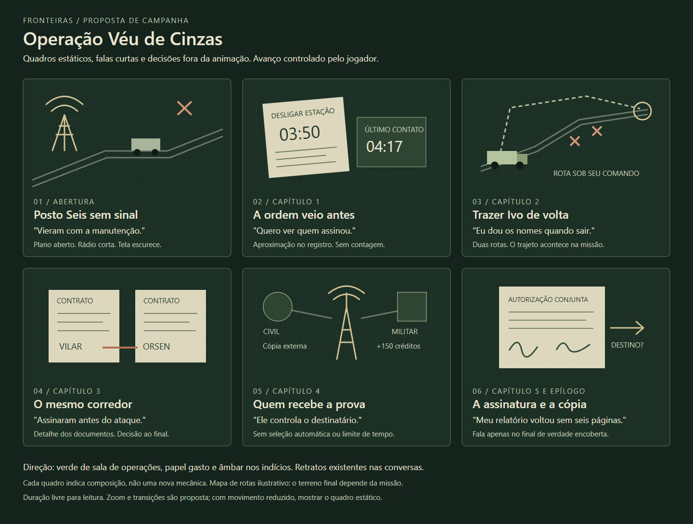

# Fronteiras: Operação Véu de Cinzas

Proposta de roteiro e direção de cenas. Data: 9 de novembro de 2026.

Este documento propõe uma revisão da campanha existente. Os diálogos abaixo são ficção nova; personagens, objetivos, escolhas, custos e condições dos finais vêm do jogo. As cenas e melhorias descritas ainda não foram implementadas.

O [parecer de viabilidade](campanha-cutscenes-viabilidade.md) descreve os recursos existentes, os pontos de integração e os testes executados. A prancha abaixo ilustra seis momentos da proposta; é um storyboard esquemático, não uma captura do jogo nem arte final.

## O que melhorar

A campanha já tem uma investigação em cinco capítulos, quatro personagens e decisões com efeitos concretos. O problema principal de apresentação é que descobertas importantes chegam em poucas falas, enquanto as conquistas intermediárias interrompem a investigação. O jogador pode lembrar de capturar um arquivo sem lembrar do que aquele arquivo prova.

A revisão mantém a estrutura e dá uma pergunta a cada missão: quem desligou o posto, quem executou a ordem, quem recebeu o dinheiro, quem ficará com as provas e quem autorizou o ataque. Cada resposta aparece num documento legível, numa conversa curta e numa consequência já prevista pelo jogo.

Três caminhos possíveis:

| Caminho | Resultado | Custo de produção relativo |
|---|---|---|
| Revisar somente os diálogos | Melhora compreensão e personalidade com os retratos atuais | Baixo |
| Diálogos com quadros ilustrados | Acrescenta locais, documentos e cortes de câmera; opção recomendada | Médio, sobretudo pela arte |
| Cinemáticas com tropas encenadas no campo | Mostra eventos usando unidades reais, mas exige direção de câmera e controle da simulação | Alto |

A proposta recomendada usa quadros 2D antes e depois das missões. O primeiro pacote pode funcionar com os retratos e placas de texto atuais. Fundos e animações entram depois, sem mudar a história.

## Elenco e direção

O jogador continua como comandante das forças mobilizadas. Helena conduz a investigação; as decisões pertencem ao jogador. A nação mantém o nome personalizado e os lugares usam a região da missão. Evitar coordenadas geográficas, bandeiras reais ou nomes fixos para regiões procedurais.

| Personagem | O que quer | Como fala | Mudança durante a campanha |
|---|---|---|---|
| Capitã Helena Duarte | Saber se suas ordens estão protegendo uma fraude | Pergunta por horários, nomes e originais; acusa depois de verificar | Aprende que reunir provas não garante que alguém possa publicá-las |
| Major Caio Reis | Trazer a unidade de volta e manter a operação funcionando | Fala de estrada, combustível, munição e gente disponível | Passa de aceitar explicações plausíveis a conferir pessoalmente as ordens |
| Ivo Varga | Sair vivo e explicar a parte que executou | Hesita ao falar de pessoas; é preciso ao falar dos rádios que configurou | Se protegido, assume seu depoimento sem reivindicar inocência completa |
| General Afonso Vilar | Manter o comando e o controle dos documentos | Começa com ordens razoáveis; usa procedimento e hierarquia quando pressionado | Perde a calma somente quando o arquivo final corre risco de ser preservado |

Usar as expressões já disponíveis: Helena focused/suspicious/determined; Reis attentive/worried/relieved; Ivo anxious/explaining/exhausted; Vilar controlled/stern/pressured. Não exigir novas poses para o primeiro pacote.

## Ritmo e regras de leitura

Os capítulos continuam liberados após 1, 3, 5 e 7 regiões distintas conquistadas. O quinto depende da conclusão do quarto e do acesso ao QG inimigo. A região inicial e reconquistas não contam. Não há redução de conquistas proposta neste pacote.

Entre capítulos, o mapa deve mostrar uma frase curta de retomada: "Temos o horário do desligamento. Falta localizar o técnico." Esse lembrete é uma melhoria de interface proposta; não existe hoje como resumo variável da investigação. O diário continua contendo as provas e decisões.

Os tempos abaixo são alvos de leitura para storyboard, não cronômetros obrigatórios. O jogador avança as falas. Toda informação sonora também aparece em texto. Pular uma conversa leva à escolha pendente; não decide pelo jogador. Uma tentativa perdida mostra a retirada e permite nova tentativa, sem tratar uma derrota local como o fim da campanha.

## Prólogo: Posto Seis

Cena C00, `opening`. Gatilho: primeira abertura da campanha de história. Alvo: 35 a 45 segundos de leitura.

O jogador ouve o posto perder contato antes de receber a versão oficial. Não mostrar Vilar organizando o ataque: a suspeita precisa nascer das provas que o jogador recupera.

| Quadro | Imagem e câmera | Som e texto |
|---|---|---|
| 1 | Tela escura com identificação "Posto Seis"; plano fixo de um rádio, se houver fundo | Estática discreta. Rádio: "Posto Seis, confirme sua situação." |
| 2 | Estrada com dois veículos de manutenção; aproximação suave opcional | Soldado: "O bloqueio caiu. Tem veículo nosso atravessando. Ninguém responde ao código." |
| 3 | Corte para a identificação do rádio; sinal interrompido | Rádio: "Consegue identificar?" Soldado: "Os caminhões de ontem. Da manutenção. Espera..." |
| 4 | Retrato de Vilar sobre a carta de operações | Diário: "Horas depois, o governo de {nação} atribui o ataque ao Diretório de Orsen. Você recebe o comando das forças mobilizadas." |

Vilar: "Retome a estrada e as comunicações. Precisamos saber até onde eles avançaram."

Helena: "As imagens do posto chegaram?"

Vilar: "Ainda estão sob análise."

Helena: "E a identificação dos veículos?"

Vilar: "Capitã, primeiro precisamos voltar ao posto. Prepare a operação."

Versão mínima: rádio em texto, retratos existentes e carta de operações, sem veículos animados. O corte do rádio é uma pausa visual; não precisa de dublagem.

## Capítulo 1: A versão oficial

Pergunta: quem desligou a estação antes do ataque?

Cena C01, `before1`, `choice-secondary` e `after1`. Abertura antes da escolha de missão; fechamento após a vitória. Alvo total: 45 a 60 segundos, fora a decisão.

Helena: "O posto perdeu o rádio às quatro e dezessete. A estação recebeu ordem de desligamento às três e cinquenta."

Reis: "Manutenção programada?"

Helena: "É o que diz a cópia. O registro de autorização ficou no depósito."

Reis: "A estação ainda pode ter a transmissão. Entramos com infantaria e deixamos o engenheiro trabalhar."

Diário: "Capture a estação em {região}. Preserve a estrutura e mantenha um engenheiro adjacente por 60 segundos ativos ou duas rodadas completas."

Reis, na decisão: "Também temos um comboio preso na outra estrada. A escolta vai para ele ou para o depósito. Você escolhe."

Preservar os efeitos exibidos na interface: salvar o comboio reserva um reconhecimento para a missão 2; capturar o depósito preserva `records`. A escolha define o objetivo secundário, mas só seu cumprimento entrega a recompensa. Não anunciar um prazo para apagar registros: hoje não existe esse temporizador.

Após a vitória:

Helena: "Confirmado. A credencial de desligamento é do nosso comando."

Reis: "Isso prova quem usou?"

Helena, com `records`: "Ainda não. Mas temos a autorização original. Já não depende só da cópia da estação."

Helena, sem `records`: "Não. Temos a cópia da estação. Falta uma segunda fonte."

Reis, se o comboio chegou: "O comboio saiu inteiro. Mandaram um reconhecimento para nossa próxima operação."

Storyboard: documento com os dois horários em plano fechado; corte para a estação na carta; tela de decisão sem animação; no debriefing, documento preservado ou espaço marcado "original não recuperado". Som: ambiente de rádio, encerrado ao entrar na escolha. Mínimo: os horários como texto, retratos e o debriefing atual.

## Capítulo 2: Ordens contraditórias

Pergunta: o que Ivo recebeu ordem de configurar?

Cena C02, `before2` e `after2`. Gatilhos: preparo da extração e vitória. Alvo total: 55 a 70 segundos, fora a decisão.

Ivo: "Vocês vieram me buscar ou me prender?"

Helena: "Primeiro vamos tirar você daí. Depois você explica o desligamento."

Ivo: "Eu configurei os transmissores. Disseram que o posto estaria vazio."

Reis: "A estrada curta está coberta por antitanques. Podemos contornar pela outra rota."

Ivo: "O caminhão vem até aqui?"

Reis: "Vai seguir as ordens do comandante. Fique pronto para embarcar."

Objetivo existente: embarcar Ivo num caminhão e chegar à extração. Ivo deve sobreviver. As rotas não são escolhas de diálogo; o jogador as executa no campo. O reconhecimento do comboio só aparece se conquistado no capítulo anterior.

Após a extração:

Vilar: "Recebi a confirmação. Uma equipe assume a custódia do técnico."

Helena: "Ainda não colhemos o depoimento."

Vilar: "Essa parte será conduzida na base."

Ivo: "Pergunte o nome do exercício."

Helena: "Qual exercício?"

Ivo: "Cinzas. Foi esse o nome que usaram comigo. Se a equipe souber, não me entregue."

Decisão existente: proteger Ivo preserva `testimony` e reduz em 50 créditos o orçamento da missão 3; entregá-lo acrescenta 100 créditos nessa missão e remove Ivo das cenas seguintes. Não afirmar que ele morreu. O jogo só estabelece que deixa de participar da história.

Storyboard: duas rotas desenhadas na carta; retrato de Ivo em enquadramento próximo; corte para a identificação da chamada de Vilar; tela da escolha. Som: motor distante opcional, sem indicar que um caminhão já chegou antes de o jogador fazê-lo. Mínimo: retratos e carta esquemática estática.

## Capítulo 3: O inimigo conveniente

Pergunta: quem se beneficiou do ataque?

Cena C03, `before3` e `after3`. Gatilhos: preparo e vitória. Alvo total: 50 a 65 segundos.

Reis: "Nossas unidades receberam ordem de racionar combustível. Esse depósito continuou recebendo carga."

Helena: "Com escolta dos dois lados da fronteira."

Ivo, apenas se protegido: "Usei a mesma configuração nos rádios dessas escoltas. Os números estão nos contratos."

Helena, apenas se entregue: "Pedi o destino da transferência de Ivo. O campo veio em branco."

Reis: "A central alimenta o arquivo. Seguramos os dois pontos para o engenheiro copiar."

Objetivo existente: capturar central e arquivo; preservar o arquivo; manter ambos aliados e um engenheiro adjacente por 60 segundos ativos ou duas rodadas completas.

Após a vitória:

Helena: "A divisão do corredor já estava assinada antes do ataque. Aqui está a data."

Reis: "Quem assinou?"

Helena: "Empresas ligadas a Vilar. Do outro lado, oficiais de Orsen."

Reis: "Se isso sair, ele vai saber de onde veio."

Helena: "Ele sabe que tomamos o arquivo. Precisamos decidir quem mais recebe uma cópia."

Decisão existente: publicar os contratos reduz em 50 créditos o orçamento da missão 4 e prepara a rede civil; manter sigilo conserva os recursos, mas usar a rede civil depois exige capturar a antena auxiliar. Os contratos são preservados nas duas opções. A publicação, sozinha, não expõe toda a conspiração.

Storyboard: plano fechado na data; deslocamento curto para os campos das partes contratantes; corte para Reis; escolha. Criar arte de documento sem texto integrado à imagem, para permitir leitura e tradução. Som: discreto ruído de sala; nenhuma música de vitória nesta descoberta. Mínimo: cartão de documento com data relativa "antes do ataque", sem inventar calendário.

## Capítulo 4: Ruptura

Pergunta: quem controla a cópia das provas?

Cena C04, `before4`, `choice-channel` e `after4`. Gatilhos: preparo, escolha de canal e vitória. Alvo total: 55 a 70 segundos.

Vilar: "Retorne à base. Traga os arquivos e entregue o comando da operação."

Helena: "Quem vai receber os documentos?"

Vilar: "O meu gabinete."

Reis: "Cancelaram nossa cobertura. Falta de combustível, segundo a mensagem."

Helena: "O depósito estava abastecido."

Reis: "Eu vi. A munição que temos está sendo distribuída. Precisamos escolher o canal antes de começar."

Helena, na escolha: "A rede civil guarda uma cópia fora dos comandos. Vilar oferece recursos pelo canal militar, mas escolhe quem recebe."

Decisão existente: rede civil permite obter `civil`; se os contratos ficaram em sigilo, a antena auxiliar também precisa ser capturada. Canal militar acrescenta 150 créditos à defesa e não fornece o recibo independente. Não apresentar isso como reforço físico: o benefício atual é crédito.

Objetivo existente: preservar a estação e acumular 180 segundos ativos ou seis rodadas de transmissão. Há ondas em 0/60/120 segundos ou rodadas 1/3/5; a última contém helicóptero. A transmissão pausa com inimigos terrestres no perímetro. Usar o painel de objetivos durante o combate; nenhuma cutscene interrompe o comando das tropas neste pacote.

Após vitória pela rede civil:

Rádio: "Recebemos os contratos. A cópia está fora da rede militar."

Helena: "O que falta para conferir a autorização?"

Rádio: "O documento original. Os contratos mostram o acordo, mas não a ordem do ataque."

Helena: "O arquivo está no comando regional de Orsen."

Após vitória pelo canal militar:

Rádio: "Recebimento confirmado pelo comando."

Helena: "Solicito identificação do responsável."

Diário: "A confirmação não identifica o destinatário."

Reis: "Vamos guardar os originais conosco."

Storyboard: chamada de Vilar; carta com a estação e os acessos; escolha; ao fim, recibo civil ou confirmação militar. Som: estática no início, confirmação curta no final. Mínimo: retratos, nomes dos canais e documento do diário. Não usar uma barra animada de transmissão na cena; o progresso pertence à missão.

## Capítulo 5: Quem ganha com a guerra

Pergunta: é possível levar a autorização intacta até a transmissão?

Cena C05, `before5` e `after5`. Gatilhos: preparo do assalto e vitória. Alvo total: 45 a 60 segundos.

Vilar: "A artilharia pode destruir o centro de comando. Está autorizado."

Helena: "Precisamos do arquivo intacto."

Vilar: "Você está expondo a unidade por documentos."

Reis: "A infantaria abre a passagem. O engenheiro copia. Depois cobrimos o caminhão."

Helena: "Guarde a ordem de bombardeio junto das outras mensagens."

Objetivo existente: capturar o centro de comando intacto, copiar por 60 segundos ativos ou duas rodadas, aproximar o caminhão, embarcar os documentos e levá-los à transmissão. A cópia aciona a reserva. Não prometer um duelo com Vilar nem colocar o general fisicamente dentro do QG de Orsen.

Após a vitória:

Helena: "A autorização tem as assinaturas. Prepararam o incidente para ocupar o corredor."

Reis: "O caminhão chegou. O arquivo foi transmitido."

Helena: "Agora vamos conferir quais cópias saíram da cadeia de comando."

Storyboard: ordem de bombardeio na carta; corte para o retrato de Helena; três pontos identificados "captura", "cópia", "transmissão"; após a vitória, autorização preservada. Som: comunicação militar; encerramento seco, sem explosão obrigatória. Mínimo: retratos e resumo de objetivo. Não mostrar tropas inimigas se rendendo: não há mecânica de rendição confirmada.

## Epílogos

Cena C06, `exposed`, `covered` ou `defeat`. Usar o final calculado pelo jogo. Alvo: 30 a 45 segundos por variante.

### Conspiração exposta

Condição existente: vitória, `contracts`, `authorization`, `civil` e pelo menos uma entre `records` e `testimony`. Salvar o comboio não impede esse final, desde que o depoimento de Ivo seja preservado. Entregar Ivo também não impede o final se os registros tiverem sido recuperados.

Diário: "Os contratos e a autorização são conferidos fora da cadeia militar, com o apoio das provas preservadas pela unidade. Vilar é afastado. Seus parceiros em Orsen perdem apoio. Começam negociações para retirar as tropas do corredor."

Reis: "Chegou a ordem para recolher a artilharia."

Helena: "De quem?"

Reis: "Do comando provisório. Conferi a origem."

Ivo, se protegido: "Vão precisar que eu conte tudo outra vez?"

Helena, se Ivo estiver presente: "Vão. Guarde sua cópia."

Diário: "O relatório de perdas permanece aberto. A responsabilização dos envolvidos continua."

Imagem: carta com posições em retirada e pasta aberta, sem anunciar paz definitiva. Mínimo: retratos e texto. Não inventar contagem de mortos; só usar números se a implementação fornecer um dado confiável e correspondente à campanha.

### Vitória com a verdade encoberta

Condição existente: vitória sem o conjunto de provas exigido para exposição.

Diário: "O QG de Orsen caiu. Vilar anuncia a vitória. Os documentos são classificados e os contratos do corredor recebem novos nomes."

Se faltar `civil`, acrescentar: "A transmissão permaneceu dentro da cadeia militar."

Se houver `civil`, mas faltarem `records` e `testimony`, acrescentar: "A cópia chegou à rede civil, mas não havia registro original nem depoimento para corroborar o desligamento."

Helena: "Meu relatório voltou. Faltam seis páginas."

Reis: "Você guardou o original?"

Helena: "Guardei."

Ivo, somente se protegido: "Meu depoimento fica com vocês."

Imagem: relatório com páginas ausentes, sem queimar a cópia preservada. Mínimo: cartão de relatório e retratos. Mostrar no diário quais provas faltaram, sem transformar o final em uma pontuação moral.

### Derrota da campanha

Condição existente: campanha perdida. Uma derrota de missão usa `retreat`, não este epílogo.

Diário: "A capital caiu. As unidades sobreviventes se reúnem para a retirada."

Reis: "O último transporte está pronto. Temos que sair."

Helena: "A estação confirmou?"

Reis, com `civil`: "Confirmou. A cópia ficou. Agora embarca."

Reis, sem `civil`: "Sem confirmação independente. Trouxe os arquivos que conseguimos preservar."

Ivo, somente se protegido: "Estou no transporte. Posso prestar o depoimento quando chegarmos."

Imagem: rota de retirada e pasta fechada. Som: motor distante, sem mostrar helicóptero ou veículo específico que não esteja garantido pelo estado da campanha. Mínimo: carta e texto.

### Retirada de uma missão

Cena curta `retreat`, sem nova ilustração: Reis: "Perdemos a posição. A unidade está se reorganizando." Helena: "As provas já preservadas continuam no diário. Vamos revisar a rota." Voltar ao mapa e deixar a nova tentativa disponível segundo as regras atuais.

## Produção de imagens e áudio

Os 12 retratos existentes cobrem o primeiro pacote. Para a versão ilustrada, produzir quatro fundos reutilizáveis: rádio do Posto Seis, interior de transporte, sala de arquivo e estação de transmissão. A carta de operações cobre deslocamentos e epílogos. Documentos devem ser montados como elementos de interface, com texto verdadeiro sobre a arte.

Direção comum para fundos: pintura militar semirrealista compatível com os retratos; verdes e cinzas discretos; luz funcional; área livre na metade inferior para legendas; sem texto, logotipos ou bandeiras incorporados. Composição larga, com o assunto principal próximo do centro para permitir corte em telas estreitas.

Referências de produção:

| Fundo | Descrição para a arte | Reutilização |
|---|---|---|
| Rádio | Rádio militar gasto sobre mesa simples, janela para estrada ao amanhecer, ninguém em primeiro plano | Prólogo e contato civil |
| Transporte | Interior parado de caminhão de transporte, bancos laterais, luz pela abertura traseira, espaço para retrato | Extração e retirada |
| Arquivo | Sala administrativa de posto militar, armários, pastas e equipamento de cópia, luz fria | Capítulos 1, 3 e 5 |
| Estação | Abrigo de transmissão com equipamento e janela para antena distante, fim de tarde | Capítulo 4 e confirmação final |

Áudio é opcional. Começar com estática, ambiente baixo e confirmação de rádio. Dublagem não é requisito para compreender ou concluir a campanha. Respeitar mudo e volume; suspender encerra o som da cena. Evitar rajadas ou alarmes que pareçam eventos reais da batalha pausada.

## Ordem de entrega e verificação

1. Revisar os textos nos IDs atuais e manter objetivos, condições e custos. Fazer uma leitura completa dos dois caminhos de Ivo e dos dois canais.
2. Prototipar C00 e C02 com retratos e um fundo cada. A abertura e a escolha sobre Ivo cobrem os fluxos iniciais. Verificar leitura em notebook e celular, teclado, pular, suspender e retomar.
3. Aplicar o mesmo formato aos demais capítulos. As artes adicionais só entram quando forem úteis para localizar uma cena ou mostrar uma prova.
4. Percorrer a campanha em RTS e turnos. Verificar as duas rotas para o final exposto, o final encoberto e a derrota. Confirmar que repetir cenas ou missões não entrega bônus de novo.

Cuidados para a implementação: a cena salva hoje usa `id` e índice da fala. Reescrever cenas pode mudar o sentido do ponto retomado em saves antigos; tratar essa compatibilidade antes da atualização. O diário reconstrói diálogos a partir do estado atual, portanto reações condicionais novas não devem reescrever silenciosamente o que o jogador já viu. O parecer técnico separado detalha a integração.

## Fontes locais consultadas

- `public/js/story.js`: personagens, cinco capítulos, cenas, decisões, provas, orçamento, progressão e finais.
- `public/js/missions.js`: objetivos efetivos, extração, temporizadores, ondas e condições de vitória.
- `public/js/story-ui.js`: abertura de cenas, retratos, pausa, escolhas, pular, retomada e diário.
- `public/css/style.css`: apresentação dos retratos, caixa de fala e adaptação para telas pequenas.
- `public/assets/characters/` e `assets/Personagens/`: retratos existentes; Helena focused e Vilar controlled foram inspecionados visualmente.

Esta revisão foi documental. Não comprova equilíbrio de combate, duração real da campanha ou execução de cutscenes no navegador.
